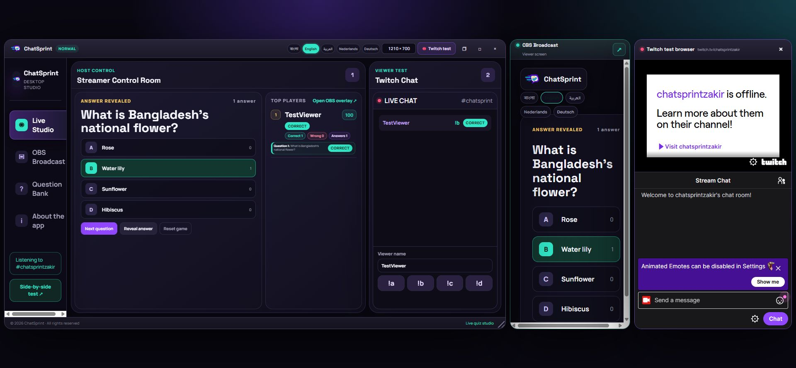
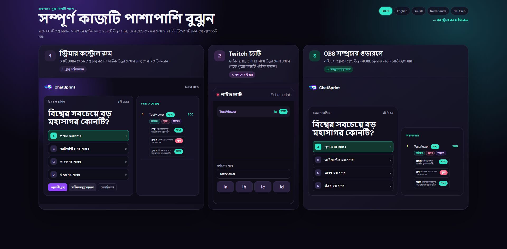
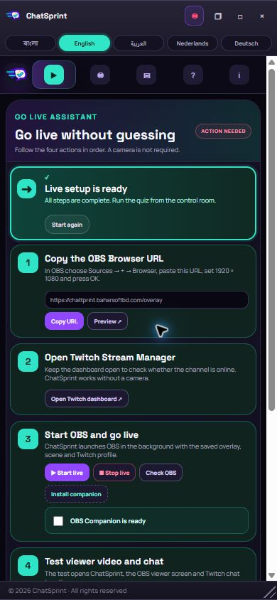

# ChatSprint

ChatSprint turns Twitch chat into a live, multilingual quiz show. A streamer launches questions from a compact control room, viewers answer in Twitch chat with `a`, `b`, `c`, or `d` (with or without `!`), and a broadcast-safe OBS overlay reveals results and leaderboards in real time.

Built from scratch during the Codex x TwitchCon Hackathon submission period with OpenAI Codex.

## Live demo

- Control room: https://chattprint.baharsoftbd.com/
- OBS overlay: https://chattprint.baharsoftbd.com/overlay
- Three-part test view: https://chattprint.baharsoftbd.com/compare
- Twitch channel: https://www.twitch.tv/chatsprintzakir

The live demo includes an in-app viewer simulator, so judges can test the complete quiz flow without sending a Twitch message.



| Results and leaderboard | Responsive mobile view |
| --- | --- |
|  |  |

## Why it matters

ChatSprint makes audience participation easy for both the streamer and the viewer. Viewers never leave chat or install another app. Streamers receive a guided, desktop-style control room, editable questions, automatic round timing, multilingual controls, and an OBS-ready visual—all in one place.

## Features

- Live Twitch chat answers through EventSub WebSockets and `channel.chat.message`.
- Accepts `a`, `b`, `c`, `d`, `!a`, `!b`, `!c`, and `!d`.
- One counted answer per viewer per round.
- Correct/wrong verdicts, 100 base points, and streak bonuses up to 100 extra points.
- Question, answer, unanswered-round, correct-answer, and wrong-answer totals.
- Two independent timers: auto-reveal and auto-next-question, each optional and configurable.
- Editable, searchable, persistent question bank with automatic language detection.
- Bangla, English, Arabic, Dutch, and German interface translations.
- Responsive desktop, tablet, and mobile layouts.
- OBS browser-source overlay and optional Windows OBS Companion.
- Side-by-side control room, viewer test, OBS preview, and embedded Twitch test browser.
- Demo mode for judging without Twitch credentials.

## Run locally

Requirements: Node.js 20 or newer.

```bash
npm ci
npm test
npm start
```

Open http://127.0.0.1:3000 and click **Live Studio**. Start a question, use the built-in viewer buttons to submit an answer, reveal the result, and open `/overlay` to see the broadcast view.

No Twitch account, OAuth token, OBS installation, or camera is required for Demo Mode.

## Connect Twitch chat

1. Register an app in the [Twitch Developer Console](https://dev.twitch.tv/console/apps).
2. Obtain a Twitch User Access Token with the `user:read:chat` scope for the account that listens to chat.
3. Copy `.env.example` to `.env`.
4. Set `TWITCH_CLIENT_ID`, `TWITCH_USER_TOKEN`, and `TWITCH_CHANNEL_LOGIN`.
5. Run `npm start`.

The token is validated at startup. ChatSprint resolves the broadcaster ID through the Twitch Helix API, opens an EventSub WebSocket, and subscribes to `channel.chat.message`. Secrets are read only from environment variables; `.env` is ignored by Git.

## OBS

Add a Browser Source in OBS:

- URL: `https://chattprint.baharsoftbd.com/overlay`
- Width: `1920`
- Height: `1080`

The optional Windows companion in `companion/` can configure the saved Browser Source and start or stop streaming through OBS WebSocket. It is not required to run or judge the web application.

## Scoring

- First valid answer from each viewer counts.
- Correct answer: 100 points.
- Consecutive correct answers: +25 points per streak step, capped at +100.
- Wrong answers receive zero points but remain visible in the round history.
- Scores and game totals reset only when the host selects **Reset game**.

## Architecture

```text
Twitch chat ──EventSub WebSocket──▶ Node.js quiz engine
                                             │
Host control room ◀──short polling/API───────┼──▶ OBS browser overlay
                                             │
Question bank ◀────JSON persistence──────────┘
```

The server is authoritative for question state, answer acceptance, scoring, result history, and timers' shared timestamps. Browser clients poll a small state endpoint so the control room and overlay recover cleanly on shared hosting.

More detail: [docs/ARCHITECTURE.md](docs/ARCHITECTURE.md)

## Testing

```bash
npm test
```

The automated suite currently covers 19 behaviors, including chat-command parsing, duplicate-answer rejection, hidden answers before reveal, correct/wrong scoring, streaks, resets, question editing/persistence, language detection, and persistent timer timestamps.

Manual judging steps: [docs/TESTING.md](docs/TESTING.md)

## Built with Codex

Codex was used as the primary build collaborator for product planning, Twitch EventSub integration, the state machine, multilingual UI, OBS workflow, question management, automated tests, deployment, responsive QA, and repeated live Twitch testing.

Primary Codex Session ID: `01a16deb-13cf-7051-946e-daaf110204e0`

## Team

- Zakir — Team Representative and Lead Developer
- Bahar — Product and UX Design

## Hackathon compliance

- New project created during the submission period.
- Interactive Twitch experience using chat, EventSub, and a stream overlay.
- Complete source, assets, setup instructions, sample questions, tests, and demo mode included.
- MIT licensed. No OAuth token, stream key, password, or `.env` file is committed.

## License

[MIT](LICENSE)
